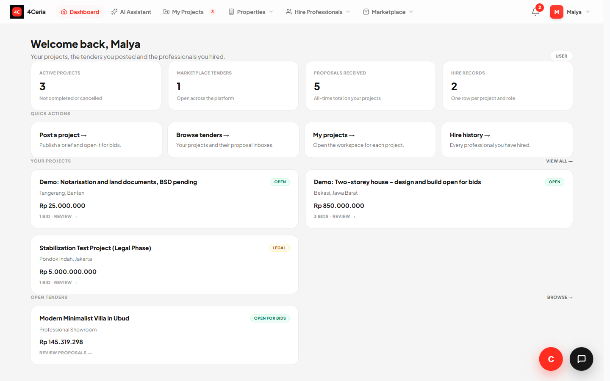

# 4Ceria Portal

**Construction coordination and a real-estate marketplace in one workspace.**
Owners publish a project, verified professionals bid, the chosen team signs a
milestone contract, materials move through suppliers and couriers, and every
payment is tracked in a PostgreSQL escrow ledger.

The product is a Go API and a Next.js 16 PWA. PostgreSQL is the only runtime
database.



## What it does

- **Project workspace** — brief, bids, interviews, contract, milestones,
  documents, daily logs, snags, change orders, extensions, handover.
- **Seven professional roles** — architect, contractor, MEP, structural,
  interior, notary and project manager, each with its own profile and bid shape.
- **Escrow ledger** — integer minor units, a ceiling per project, retention,
  platform fee, dispute freeze and an append-only movement history.
- **Material marketplace** — supplier storefront, catalogue, quotes, orders,
  payment proof and delivery jobs.
- **Logistics Job Radar** — couriers see nearby delivery jobs and update status.
- **Ceria AI** — a project-aware assistant with tool calls, per-user memory and
  strict refusals for money mutations.
- **Installable PWA** — offline shell, install prompt, push notifications and
  an update flow. No app store.

## Stack

| Layer | What |
|---|---|
| API | Go 1.27, `net/http`, pgx v5 |
| Database | PostgreSQL 17+ (tested against 18.6), forward-only migrations |
| Frontend | Next.js 16 App Router, React 19, Tailwind CSS 4, TypeScript 7 |
| Auth | Sanctum-compatible bearer tokens in an httpOnly cookie |
| Money | integer minor units; no floats |
| AI | Google ADK v2 + DeepSeek |
| Files | local disk with HMAC-signed URLs, or S3-compatible storage |
| Realtime | Server-Sent Events for the assistant; push for notifications |

## Quick start

Requirements: Go 1.27+, Node 20+, PostgreSQL 17+.

```bash
# 1. Database: create a C-collation database, apply migrations, load the demo.
node tools/db/reset-demo.mjs

# 2. API
cp .env.example .env
go run ./cmd/gateway --addr=:8099

# 3. Web (second terminal)
cd web && npm ci && API_ORIGIN=http://127.0.0.1:8099 npm run dev
```

Open <http://127.0.0.1:3000>.

The reset script accepts `--database=name`, reads the standard `PGHOST`,
`PGPORT`, `PGUSER` and `PGPASSWORD` variables, and needs `psql` on `PATH` (or
`PSQL_BIN`).

### Demo accounts

All demo accounts use the password **`123456`**.

| Role | Email |
|---|---|
| Owner | `client@example.test` |
| Architect | `giska@example.test` |
| Contractor | `anindia@example.test` |
| Interior | `abel@example.test` |
| Notary | `rede@example.test` |
| Project manager | `pm@4c.id` |
| Supplier | `akmal@example.test` |
| Courier | `fariz@example.test` |
| Admin | `admin@4c.id` |

The seed includes eight projects, six property listings, twelve catalogue
items and the full professional directory.

## Verify

```bash
node scripts/verify.mjs          # gofmt, vet, go test, action policy, web build
node scripts/verify.mjs --db     # plus PostgreSQL from scratch, seed, SQL suites
```

`--db` creates `4ceria_pgcheck` with `LC_COLLATE=C`, applies every migration,
loads `db/postgres/seed.sql`, runs `db/postgres/tests/escrow_behaviour.sql` and
then runs the Go suites against that database.

## Documentation

| | |
|---|---|
| [`docs/ARCHITECTURE.md`](docs/ARCHITECTURE.md) | Topology, request lifecycle, storage, background jobs, deploy |
| [`docs/DOMAIN.md`](docs/DOMAIN.md) | Roles, project lifecycle, bids, disputes |
| [`docs/MONEY.md`](docs/MONEY.md) | The escrow ledger and its invariants |
| [`docs/API.md`](docs/API.md) | Route manifest, conventions, errors, SSE |
| [`docs/OPERATIONS.md`](docs/OPERATIONS.md) | Environment, reset, verification, backups |
| [`docs/PORTFOLIO.md`](docs/PORTFOLIO.md) | The demo script and screenshot gallery |
| [`AGENTS.md`](AGENTS.md) | Working rules for AI agents and contributors |

## Deployment

The API ships as a single Go binary. The image builds from the `Dockerfile`
and serves `--addr=:8080`; set `DATABASE_URL`, `APP_KEY` and `APP_URL`, and a
storage directory or S3 credentials.

The web app is a standard Next.js standalone build. Set `API_ORIGIN` at
runtime to the API's server-side address; the browser only sees the Next
origin, and `/api/*` plus `/storage/*` are proxied with the httpOnly session.

**This repository is a portfolio project.** It is not a hosted service. The
seeded accounts, properties and projects are demonstration data.

## License

[MIT](LICENSE)
