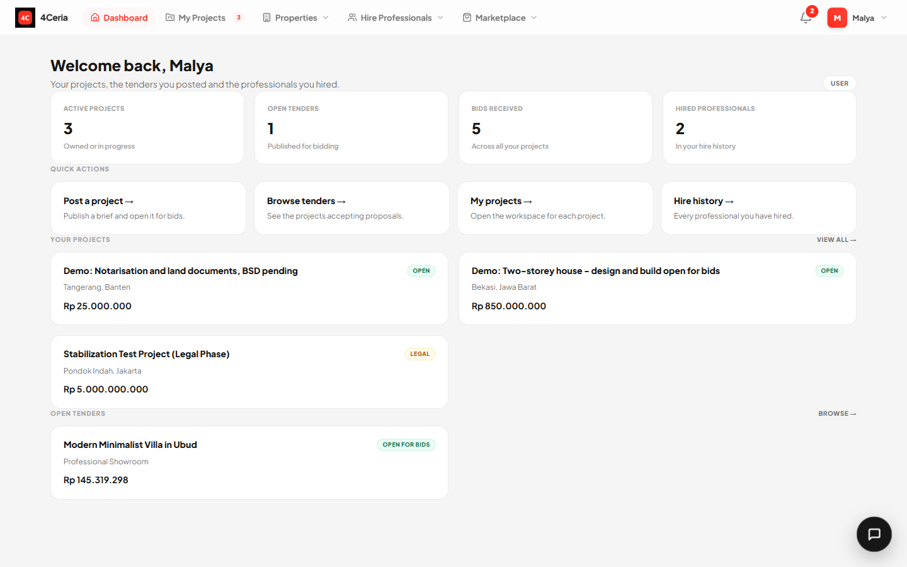
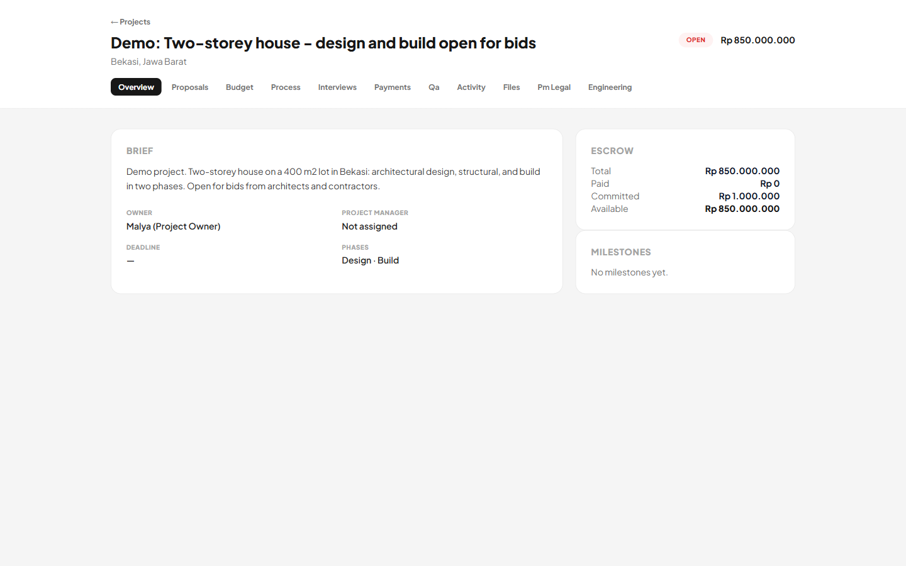

# 4Ceria Portal

Construction-coordination and real-estate marketplace. A Go API serves every
endpoint from PostgreSQL (including auth); a Next.js 16 App Router application
is the frontend. MySQL is only the one-time legacy seed (`db/mysql/` + `cmd/etl`).

```
Next.js (web/)  ──HTTP──▶  Go gateway (cmd/gateway)  ──▶  PostgreSQL (all data + auth)
```

## Screenshots

| | |
|---|---|
|  |  |
| Owner dashboard | Project workspace with escrow, milestones and phase tabs |

More in [`docs/PORTFOLIO.md`](docs/PORTFOLIO.md): the full gallery, demo
accounts, and a two-minute demo script.

## History

This repository used to be a Laravel 13 + MySQL + React SPA application. It was
ported to Go + PostgreSQL + Next.js with a byte-identical contract, verified
endpoint by endpoint against the running legacy app. The last commit that
carries the Laravel application is tagged [`laravel-final`](https://github.com/davinakmalyasha/4Ceria-4C-/tree/laravel-final);
`git diff laravel-final main` is the retirement.

## Layout

| Path | What it is |
|---|---|
| `cmd/gateway` | The API server. Reads the route manifest and registers every route. |
| `cmd/etl` | The MySQL → PostgreSQL loader and verifier. |
| `internal/httpapi` | Handlers, middleware, money and request plumbing. |
| `internal/domain` | Pure domain packages: money, escrow, termin plan, authz, identity. |
| `internal/jsonphp` | PHP-compatible JSON encoder (the wire contract). |
| `web/` | Next.js 16 application (standalone build). |
| `routing/routes.yaml` | The route manifest the gateway serves. |
| `db/postgres/migrations` | The PostgreSQL schema, forward-only. |
| `db/mysql/` | Frozen legacy seed (one-time ETL source, not runtime). |
| `spec/enums.yaml` | Every enum value list, in MySQL order. |
| `docs/` | Domain, money, conventions, architecture, ADRs. |

## Run it

Requirements: Go 1.27+, Node 20+, PostgreSQL 17, MySQL 9.6.

```bash
# 1. Database (PostgreSQL only at runtime)
psql -d postgres -c 'CREATE DATABASE 4ceria_pgcheck'
for f in db/postgres/migrations/*.sql; do psql -d 4ceria_pgcheck -f "$f"; done
psql -d 4ceria_pgcheck -f db/postgres/seed.sql   # demo data, no MySQL needed

# One-time legacy re-seed from MySQL (optional, needs a running MySQL once):
#   mysql -uroot -e 'CREATE DATABASE 4ceria'
#   mysql -uroot 4ceria < db/mysql/schema.sql
#   mysql -uroot 4ceria < db/mysql/demo.sql
#   MYSQL_DSN='root@tcp(127.0.0.1:3306)/4ceria?parseTime=false' DATABASE_URL='postgres://postgres@127.0.0.1:5432/4ceria_pgcheck' go run ./cmd/etl -all -truncate

# 2. API (no MYSQL_DSN needed — auth is PostgreSQL-native)
cp .env.example .env
go run ./cmd/gateway --addr=:8099

# 3. Frontend
cd web && npm ci && API_ORIGIN=http://127.0.0.1:8099 npm run dev
```

The demo accounts all use the password `123456` (for example
`client@example.test`).

## Verify

```bash
node scripts/verify.mjs          # gofmt, vet, go test, frontend typecheck + build
node scripts/verify.mjs --db     # plus the PostgreSQL baseline and the ETL row check
```

The database gate builds PostgreSQL from scratch, diffs it against the live
MySQL schema, loads the ETL and asserts both engines hold the same number of
rows. `bash scripts/ci/action-policy.sh` asserts every action and image is
pinned.

## Deployment

**This repository is not deployed.** It is a portfolio project: it handles real
money and file uploads, so a public demo would be attack surface rather than a
demo. See [`docs/PORTFOLIO.md`](docs/PORTFOLIO.md).

If it were deployed, the shape is:

- **API** — the `Dockerfile` (Go binary, `--addr=:8080`) on any container host,
  with `DATABASE_URL`, `APP_KEY`, `APP_URL` and the storage/mail
  variables (no `MYSQL_DSN` at runtime).
- **Frontend** — `web/` on Vercel (`next build`, standalone output), with
  `API_ORIGIN` pointing at the API at runtime.
- **PostgreSQL** — the application datastore + auth (migrations applied in order).
- **MySQL** — one-time seed source only; not needed at runtime.
- **Uploads** — local disk by default (`PUBLIC_STORAGE_ROOT`, `EVIDENCE_DIR`); a bucket only if `S3_*` is set.

## Documentation

| | |
|---|---|
| [`AGENTS.md`](AGENTS.md) | Start here: working rules and traps. |
| [`docs/ARCHITECTURE.md`](docs/ARCHITECTURE.md) | Topology, request lifecycle, storage, deploy. |
| [`docs/DOMAIN.md`](docs/DOMAIN.md) | Actors, project lifecycle, money flow. |
| [`docs/MONEY.md`](docs/MONEY.md) | The escrow model and its invariants. |
| [`docs/CONVENTIONS.md`](docs/CONVENTIONS.md) | Auth, authorization, uploads, responses. |
| [`docs/POSTGRES-SCHEMA.md`](docs/POSTGRES-SCHEMA.md) | The PostgreSQL target schema. |
| [`docs/adr/`](docs/adr/README.md) | The decisions, with their consequences. |
