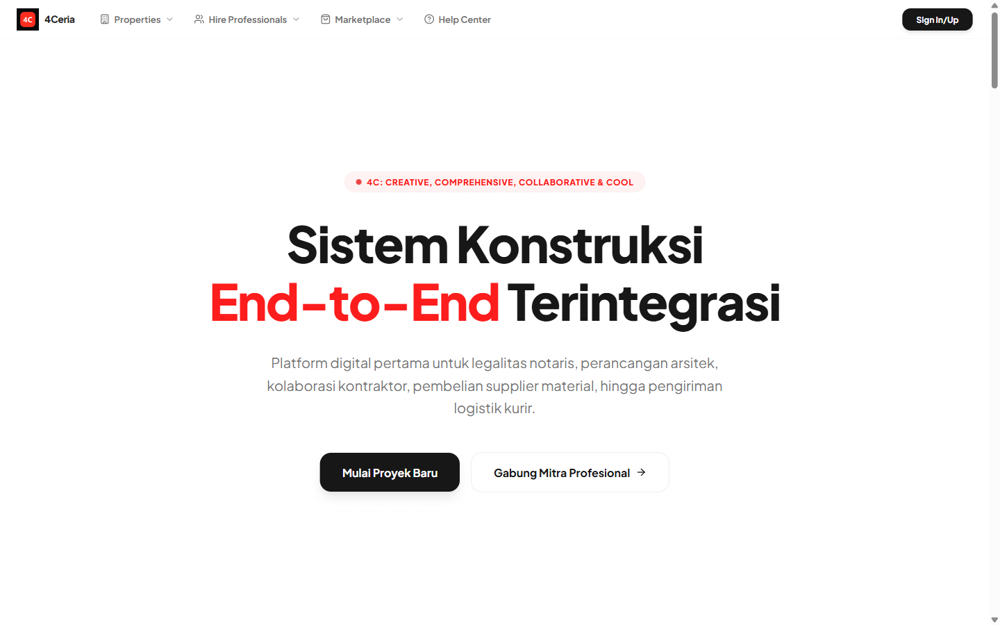
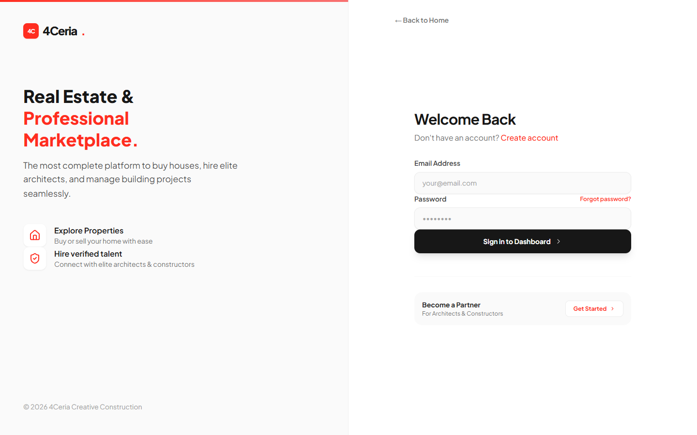
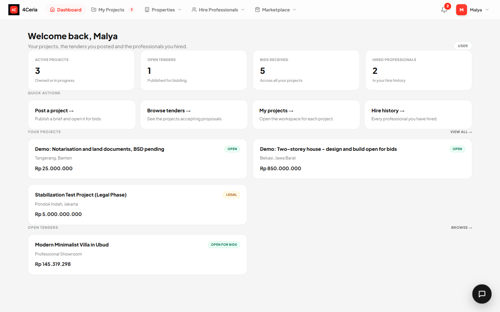
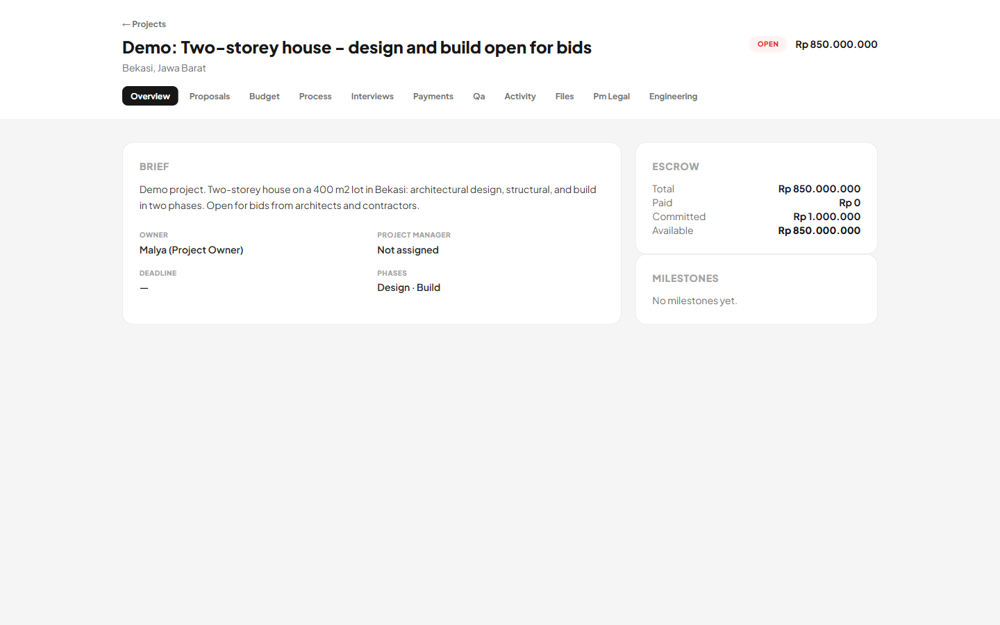
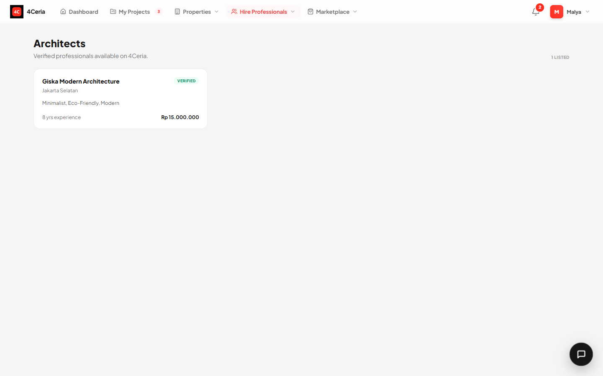
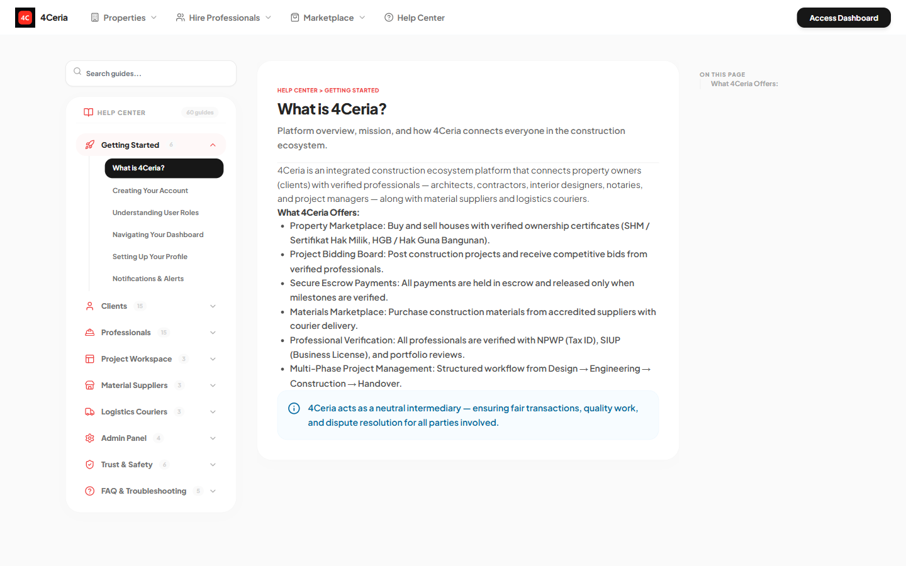
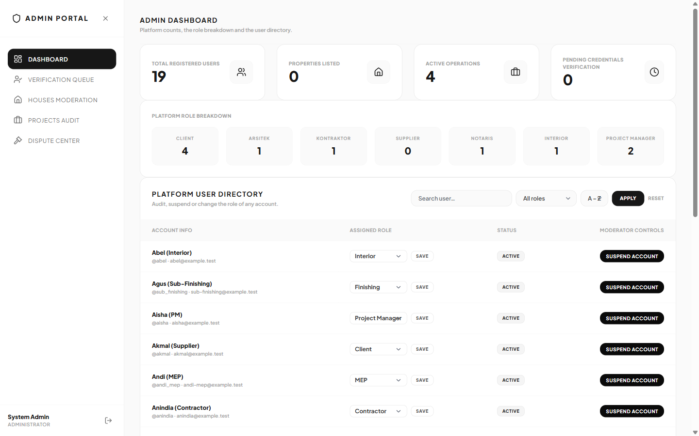
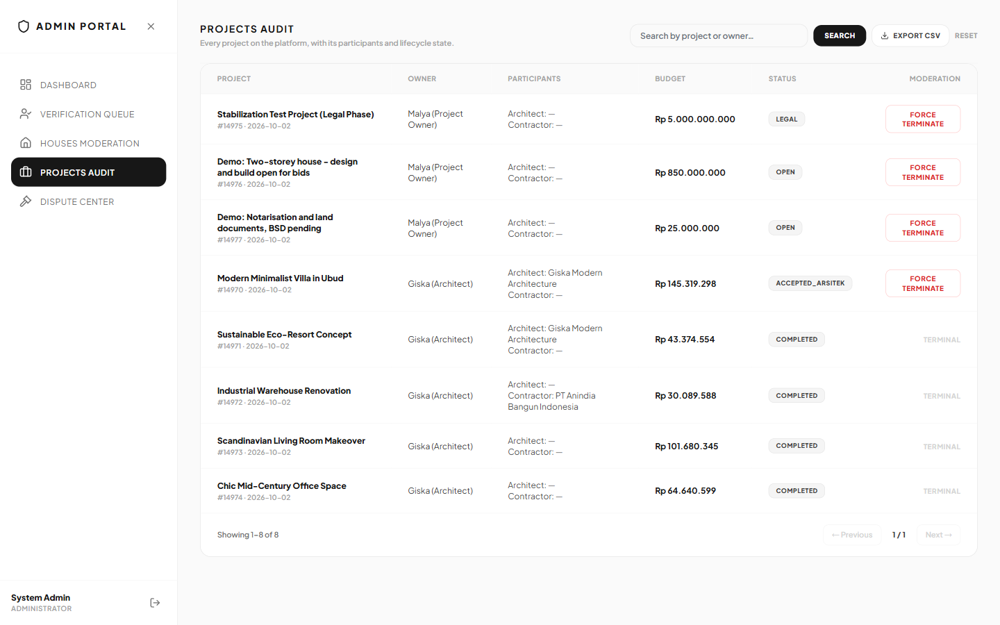

# Portfolio guide

What this project is, what to look at, and how to demo it in two minutes.

## The one-paragraph pitch

4Ceria is a construction-coordination and real-estate marketplace: owners post
projects, professionals bid per role, payments move through an escrow ledger,
and disputes are arbitrated by an admin. It was rewritten from a Laravel + MySQL
+ React SPA into **Go + PostgreSQL + Next.js** while the old application stayed
deployed as a byte-parity oracle. The port is finished; the legacy app is
preserved on the `laravel-final` tag.

## The interesting parts

| What | Where | Why it matters |
|---|---|---|
| Byte-identical port | `internal/jsonphp`, `spec/` history | The API's JSON is a wire contract: key order, number formatting and escaping were reproduced, not approximated. |
| Escrow arithmetic | `internal/domain/money`, `internal/domain/escrow` | Integer minor units, one formula for "how much is left", retention split, platform fee, refunds. |
| Database invariants | `db/postgres/migrations`, `db/postgres/tests/escrow_behaviour.sql` | The ledger's `CHECK` constraints make an invalid state impossible, not merely unlikely. |
| Route manifest | `routing/routes.yaml`, `internal/httpapi` | 296 endpoints, every one registered; a manifest route without a handler fails the build. |
| Identity split | ADR-0018, `cmd/etl` | MySQL keeps `users`/tokens/roles while PostgreSQL holds everything else; the ETL proves the mirror row for row. |
| Decisions | `docs/adr/` | 22 ADRs with context, consequences and rejected alternatives — including the ones that were wrong. |

## Screenshots

| | |
|---|---|
|  |  |
| Public landing page | Sign in |
|  |  |
| Owner dashboard | Project workspace: brief, escrow, milestones, phase tabs |
|  |  |
| Verified professional directory | Help centre (17 interactive widgets) |
|  |  |
| Admin dashboard | Project audit and force-termination |

## Demo accounts

Local only — seeded by `db/mysql/demo.sql`. Every account uses the password
`123456`.

| Role | Email |
|---|---|
| Owner / client | `client@example.test` |
| Admin | `admin@4c.id` |
| Architect | `giska@example.test` |
| Contractor | `anindia@example.test` |
| Supplier | `akmal@example.test` |
| Notary | `rede@example.test` |
| Project manager | `aisha@example.test` |

## Two-minute screen recording script

Record at 1440×900, browser at 100 %, no audio needed (captions in the edit).

| Time | Screen | Say / show |
|---|---|---|
| 0:00–0:10 | `README.md` on GitHub | "4Ceria — a construction marketplace rewritten from Laravel to Go and Next.js." |
| 0:10–0:25 | Landing page | Scroll the hero, the three pillars, the footer. |
| 0:25–0:45 | Log in as `client@example.test` | Dashboard: active projects, open tenders, bids received, quick actions. |
| 0:45–1:10 | `/projects/14976` | Point at the escrow panel (total, paid, committed, available), then the phase tabs: Proposals, Budget, Payments, Files. |
| 1:10–1:25 | `/dashboard/architects` | Verified professionals, the profile card, the price range. |
| 1:25–1:40 | `/help` | Search a guide; expand a category. |
| 1:40–1:55 | Log out, log in as `admin@4c.id` | Admin dashboard: counts, role breakdown, user directory; then Projects Audit. |
| 1:55–2:00 | `docs/adr/` | "The decisions are written down — including what was rejected." |

## What is deliberately not here

- **No live deployment.** The app handles real money and file uploads; a public
  demo would be an attack surface, not a portfolio. The screenshots and the
  recording are the demo.
- **No real credentials or data.** Every account is a seeded fixture; every
  project is demo data.
- **Known security gaps are listed, not hidden** — see `SECURITY.md`. The honest
  list is part of the work.

## Running it

See [`../README.md`](../README.md). Short version: PostgreSQL + MySQL, apply
`db/postgres/migrations` and restore `db/mysql/schema.sql` + `demo.sql`, then
`go run ./cmd/gateway` and `cd web && npm run dev`.
