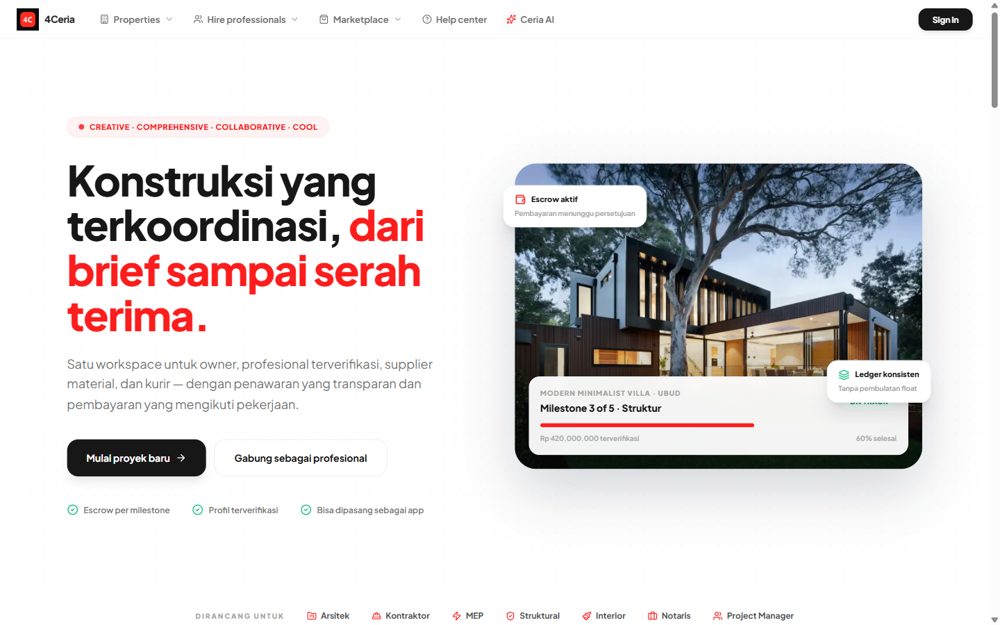
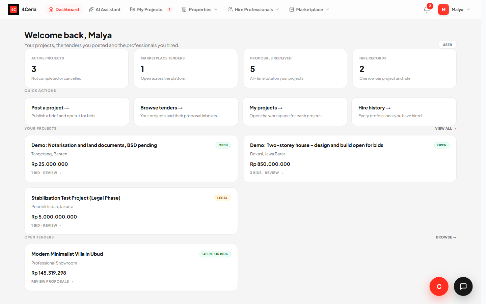
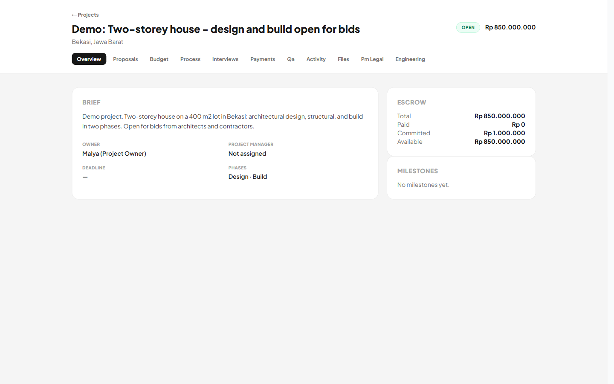
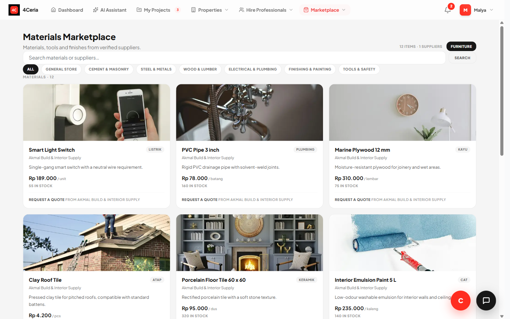
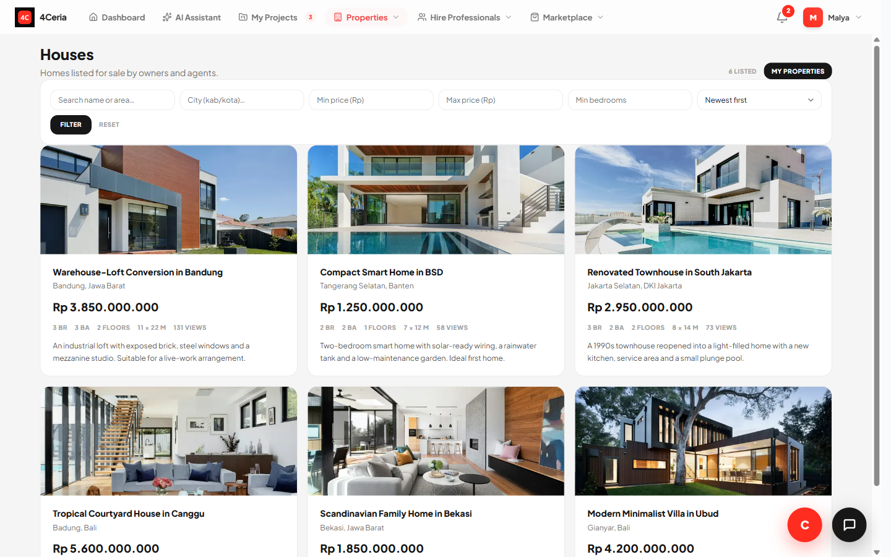
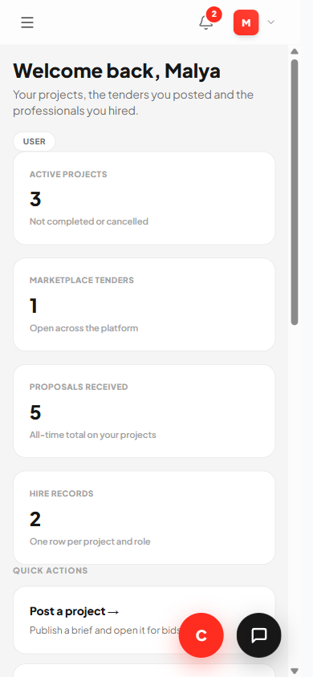
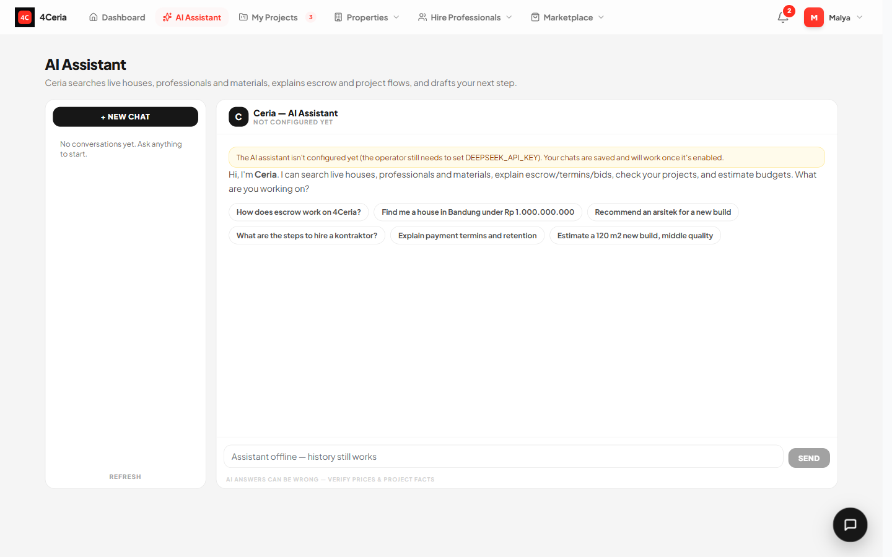
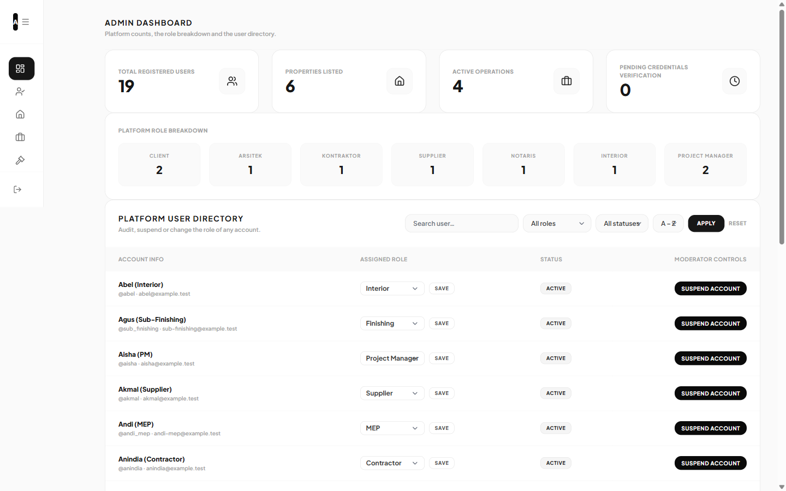

# Portfolio

**4Ceria is one workspace for the whole construction chain**: an owner posts a
project, seven kinds of verified professional bid, the chosen team signs a
milestone contract, suppliers and couriers move materials, and PostgreSQL keeps
an escrow ledger that both sides can inspect.

It is a full-stack reference implementation, not a landing-page mockup: 325 API
routes, real authentication, real uploads, a real ledger and a database-enforced
set of money invariants.

## The two-minute demo

1. **Sign in as the owner** (`client@example.test` / `123456`).
2. The dashboard shows active projects, proposals received and hire records.
   Open *Demo: Two-storey house*.
3. In the workspace, show the brief, the proposal inbox and the milestone
   process. The escrow card shows total / paid / committed / available.
4. Open **Browse houses** in the same session, then the property detail. The
   listing is public; the contact action asks for a sign-in.
5. Sign out, and sign in as the contractor (`anindia@example.test`).
   *My Proposals* shows the bid pipeline and any invitation; accept one and the
   interview room opens.
6. Sign in as the admin (`admin@4c.id`) and open *Dispute Center* to show the
   moderation surface that freezes payments.
7. Install the PWA from the install card, then go offline: the offline shell
   and cached assets still open.

## Screenshots

| | |
|---|---|
|  |  |
| Public landing page | Owner dashboard |
|  |  |
| Project workspace | Material marketplace |
|  |  |
| Public property feed | Mobile layout (installable PWA) |
|  |  |
| Ceria AI assistant | Admin dashboard |

## What is implemented

| Area | Evidence |
|---|---|
| Auth | PostgreSQL opaque tokens, httpOnly cookie, reset flow, timing equalisation |
| Project lifecycle | 48 workspace handlers across brief, bids, contract, budget, milestones, documents, snags, handover |
| Money | Integer minor units, escrow ledger, retention, platform fee, dispute freeze, SQL invariants |
| Marketplace | Supplier catalogue, quotes, orders, payment proof, delivery jobs and reviews |
| Directory | Seven professional roles, verification status, portfolios, firm workspace |
| Property | Listings, rooms, photos, filters, favourites, questions |
| AI | ADK v2 agents, 12 read-only tools, PostgreSQL long-term memory, embedded skills, MCP server, quotas, SSE stream |
| Performance | `encoding/json/v2` wire encoder with a byte-compat oracle, gzip middleware, batched page queries, per-response deadlines, benchmarked in `docs/PERFORMANCE.md` |
| PWA | Manifest, install prompt, offline shell, update flow, push |
| Security | Path-safe uploads, body limits, scoped rate limits, signed private URLs, no secrets in the seed |

## Engineering decisions worth a look

- **The route manifest is the contract.** `routing/routes.yaml` drives the
  router and a test fails when a route has no handler.
- **The JSON wire is fast without moving.** `internal/jsonwire` runs on
  `encoding/json/v2` with an old-encoder oracle, so ordered keys and stored
  fragments survive while list encoding drops from ~12 ms to ~1.3 ms and
  40k allocations to 3 in the benchmark.
- **One money model.** `internal/domain/money` and `internal/domain/escrow`
  own every calculation; the database function is the only ledger writer.
- **The database is the second test suite.** `db/postgres/tests/escrow_behaviour.sql`
  drives the real function, so the Go mirror cannot agree with itself.
- **The API token never reaches JavaScript.** Server actions and two proxy
  routes attach it; the browser sees only an httpOnly cookie.
- **The PWA is conservative.** API responses and uploaded files are never
  cached, so a shared device cannot show one account's data to the next person.

## Deliberate limits

- The demo data is fictional; there is no payment gateway, e-signature
  provider or KYC vendor connected.
- The platform fee and retention rates are configuration, not a live pricing
  decision.
- The repository is not deployed; the demo accounts are intentionally public.

## Demo accounts

All accounts use `123456`.

| Role | Email |
|---|---|
| Owner | `client@example.test` |
| Architect | `giska@example.test` |
| Contractor | `anindia@example.test` |
| Interior | `abel@example.test` |
| Notary | `rede@example.test` |
| Project manager | `pm@4c.id` |
| Supplier | `akmal@example.test` |
| Courier | `fariz@example.test` |
| Admin | `admin@4c.id` |

Regenerate the data with `node tools/db/reset-demo.mjs`.
